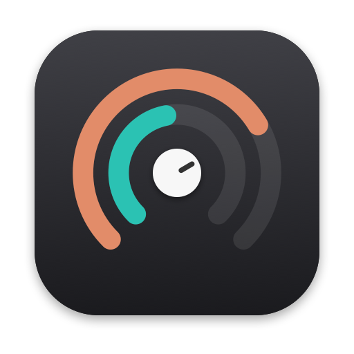
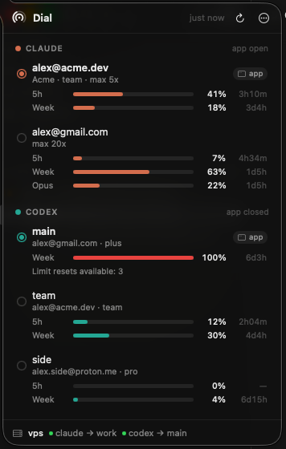

<p align="center">
  
</p>

<h1 align="center">dial</h1>

<p align="center">
  Switch <b>Claude</b> and <b>Codex</b> accounts in one keystroke: CLIs, desktop apps and remote machines.<br>
  See every account's usage limits and reset times in your menu bar.
</p>

<p align="center">
  
</p>

If you have more than one Claude or ChatGPT/Codex account (personal, work, team seats), you have probably juggled `/login`, copied `auth.json` files around, and lost track of which account has headroom left. dial stores each login once and switches between them without opening the browser again. It also runs several accounts side by side, keeps a remote dev box on the same account as your laptop, and puts all usage limits in one place.

- **Instant switching.** `dial use work` swaps the Claude Code / Codex CLI login and the matching desktop app. Remote machines follow automatically.
- **No re-authentication.** Each account logs in once. dial keeps stored logins fresh and folds tokens refreshed by the CLIs back into its vault.
- **Side by side.** Run several accounts at the same time: separate Claude Desktop and Codex Desktop windows (`dial open`) and isolated CLI sessions (`dial run`).
- **Remote sync.** When you switch on your Mac, your VPS switches too, so Claude Code Remote Control and Codex sessions there run on the same account. It works over plain `ssh`. Account changes made outside dial (signing in inside Claude Desktop, `codex login`) are followed within seconds.
- **Usage at a glance.** 5-hour and weekly windows, per-model limits, reset countdowns, credits and limit-reset counts for every account, in the menu bar or terminal.
- **Small and fast.** A dependency-free Go CLI (≈7 MB) plus a native Swift menu bar app using about 27 MB of RAM. No Electron, no background daemon, no telemetry.
- **macOS and Linux.** The CLI, remote sync and usage work everywhere. The desktop app features and menu bar are macOS only. On Linux, `dial watch` and a waybar module cover the display.

## Install

```bash
curl -fsSL https://raw.githubusercontent.com/medpar/dial/main/scripts/install.sh | bash
```

- **macOS:** installs `Dial.app` into `/Applications` (it lives in the menu bar) and links the `dial` command into `~/.local/bin`.
- **Linux:** installs the `dial` binary into `~/.local/bin` and adds a cron entry that refreshes idle logins every 6 hours.

To build from source, you need Go 1.25+, plus Swift 5.10+ (the Xcode command line tools are enough) for the menu bar app:

```bash
git clone https://github.com/medpar/dial && cd dial
./scripts/build-macos.sh                  # dist/Dial.app + CLI binaries for macOS and Linux
DIAL_FROM=$PWD/dist ./scripts/install.sh
```

The app is ad-hoc signed. If Gatekeeper complains, run `xattr -dr com.apple.quarantine /Applications/Dial.app`.

## Quick start

```bash
dial import            # bring in the accounts you're logged into right now
dial add claude        # log in another Claude account (your current login is untouched)
dial add codex         # …or another Codex account (--device on headless machines)
dial                   # status of every account
dial use work          # switch CLI + desktop app (+ remotes) to "work"
dial claude 2          # shorthand: switch Claude to account #2
dial best codex        # switch Codex to the account with the most headroom
```

Example output:

```text
◖ CLAUDE
 ● 1 alex@acme.dev   Acme · team · max 5x ⌂app
     5h session       ████████▏···········  41%  resets in 3h11m (16:46)
     Weekly           ███▌················  18%  resets in 3d4h (Thu 18:34)
   2 alex@gmail.com  max 20x
     5h session       █▍··················   7%  resets in 4h35m (18:10)
     Weekly · Opus    ████▍···············  22%  resets in 1d5h (Tue 19:34)

◗ CODEX
 ● 1 main        plus ⌂app
     Weekly           ████████████████████ 100%  resets in 6d3h (Sun 17:34)
     Limit resets available: 3
   2 team        team
     5h session       ██▍·················  12%  resets in 2h05m (15:40)

⇄ vps  ✓ claude → work 3m ago  ✓ codex → main 3m ago
```

You can refer to an account by its id, label, email, list number (`claude:2`) or a unique prefix.

### Menu bar

Click the dial icon or press **⌥⌘D** anywhere.

- **Switch:** click an account. dial switches its CLI login and desktop app, and syncs your remotes.
- **Hover actions:** open the account in its own desktop window, or start a Terminal session as that account.
- **Icon:** the outer arc shows the active Claude account's peak usage and the inner arc the active Codex account's. The knob grows when either passes 90%.
- **Settings (⋯ menu):** refresh interval, a percentage readout next to the icon, launch at login, and adding accounts.

If the icon is hidden behind the notch, ⌘-drag it further right in the menu bar or use the shortcut.

## Desktop apps

**Codex Desktop** reads the same `~/.codex/auth.json` as the CLI, so `dial use` switches both and restarts the app if it is open.

**Claude Desktop** keeps its own sign-in. dial saves each account's sign-in, so you can switch the main window or run accounts side by side:

```bash
dial desktop add claude      # sign another account into Claude Desktop; it opens in its own window
dial use personal            # switch the CLI and the main Claude window together
dial desktop use work        # switch only the main window
dial open personal           # open a saved account in its own window
```

**How sign-in works.** Claude Desktop finishes a sign-in through a `claude://` link that only the window which started it accepts, and macOS delivers that link to just one running Claude window. When several were open, the sign-in often landed in the wrong one and was ignored. `dial desktop add` therefore:

1. briefly closes your Claude windows;
2. opens a single sign-in window;
3. saves the new login as soon as you're in;
4. reopens your windows, with the new account in its own window.

Nothing is logged out. In the menu bar this is **Add account → Claude Desktop account…**, or the person icon on an account that has no Desktop sign-in yet.

**Several accounts at once.** `dial open <account>` starts a separate Claude Desktop or Codex Desktop instance signed in as that account, each with its own data directory.

- dial identifies each window by the login inside it, so the menu always shows which account is in the main window and which are in their own windows.
- **Codex windows:**
  - They share your config, skills, rules, memories and plugins.
  - Each keeps its own thread history and state, so windows never fight over a database or inherit another account's remote-control identity.
  - Remote (SSH) projects run on the remote host's login. That is the account dial keeps the host on, normally your main account.

## Side-by-side CLI sessions

```bash
dial run work                  # claude as "work" in this terminal
dial run codex:team -- exec "fix the tests"
eval "$(dial env personal)"    # point this shell at an account (sets CLAUDE_CONFIG_DIR / CODEX_HOME)
```

Each account gets a private config directory and private credentials. Settings, skills, plugins, commands and project history are linked from your normal `~/.claude` / `~/.codex`, so every session feels the same.

## Remote machines

dial keeps a remote host on the same account as your laptop. That matters for Claude Code Remote Control and anything else that has to match the account in your desktop app.

```bash
# on the remote: install dial (same one-liner), then on your Mac:
dial remote add vps me@vps            # any ssh destination or ~/.ssh/config alias
dial remote seed vps --all            # give the remote its own login for each account (one browser click each)
dial use work                         # …the remote switches with you from now on
dial remote status vps
```

**Why seed instead of copying tokens?** Claude and OpenAI rotate refresh tokens, and each one works only once. If two machines share a copy of one login, whichever refreshes second gets logged out.

- `dial remote seed` mints a fresh login for the remote on your Mac (your browser is already signed in) and installs it there. Each machine then refreshes its own tokens independently.
- After seeding, each switch only tells the remote *which* account to activate. No secrets cross the wire.
- `--share` copies your existing login instead. That is safe only if you never use the account on both machines at once.

## How it works

```text
~/.dial/
  profiles/<provider>/<id>/   one directory per account: metadata + credentials (0600)
  desktop/claude/<account>/   parked Claude Desktop sign-ins; doubles as that account's window data dir
  desktop/codex/<id>/         CODEX_HOME + data dir for Codex windows
  run/claude/<id>/            CLAUDE_CONFIG_DIR for `dial run`
  usage.json  state.json  config.json
```

- **One source of truth per account.**
  - The live CLI location (`~/.codex/auth.json`, or the `Claude Code-credentials` keychain item plus `oauthAccount` in `~/.claude.json`) only ever holds a copy of the active account.
  - Before every switch, dial folds that copy back into the vault, keeping whichever is newer.
  - A login you created with `/login` behind dial's back is imported, never lost.
- **Never two refreshers.**
  - dial only refreshes accounts that aren't live anywhere: not in the CLI, not in an open window, not in a running `dial run`.
  - Refreshes use compare-and-swap and are rate-limited.
  - `dial keepalive` (6-hourly from the menu bar app on macOS, from cron on Linux) keeps idle logins from expiring.
- **Claude Desktop sign-ins live in exactly one place.**
  - A sign-in is a slice of the app's data: cookies, web storage and the encrypted token cache in `config.json`. Your settings, MCP config and sessions stay put.
  - Switching quits the app, parks the current slice under `~/.dial/desktop/claude/<account>`, moves the target slice in, and relaunches.
  - A parked directory is a complete user-data dir, so `dial open` runs it as a separate instance.
- **The keychain is accessed through `/usr/bin/security`.** This is the same tool Claude Code uses, so neither program triggers permission prompts. Secrets go over stdin rather than argv whenever they fit.
- **Usage comes from the same endpoints the CLIs use** for `/usage` and `/status`:
  - Claude: `api.anthropic.com/api/oauth/usage`
  - Codex: `chatgpt.com/backend-api/wham/usage`
  - Results are cached (2 min by default) and fetched concurrently with jitter; dial backs off on 429.

More detail is in [docs/DESIGN.md](docs/DESIGN.md).

## Commands

```text
dial                          status of every account (cached usage)
dial status [--refresh]       … refreshing stale usage first
dial use <account>            switch CLI + desktop app (+ remotes)   [--cli | --desktop] [--no-remote]
dial claude|codex <account>   shorthand for use
dial next|best claude|codex   cycle, or pick the account with most headroom
dial add claude|codex         log in a new account         [--label] [--email] [--sso] [--device]
dial login <account>          renew an account's login
dial import [live|codex-auth|cps]
dial ls | rename <account> <label> [--id] | rm <account>
dial run <account> [-- args]  dial env <account>    dial open <account>
dial desktop [add claude | login <account> | use <account>]
dial remote add|ls|rm|status|seed|sync
dial usage [account…]         dial watch            dial waybar
dial keepalive                dial follow           dial doctor
dial config [key [value]]
```

Most commands accept `--json`.

**Migrating:** `dial import codex-auth` reads [codex-auth](https://github.com/loongphy/codex-auth)'s `~/.codex/accounts`. `dial import cps --disable-cps` exports [codex-profile-switcher](https://github.com/4LAU/codex-profile-switcher) profiles through its own CLI, then turns off its token renewal so the two tools never rotate the same tokens.

### Linux status bars

```jsonc
// waybar
"custom/dial": { "exec": "dial waybar", "return-type": "json", "interval": 300 }
```

## Requirements and caveats

- **Platforms:** macOS 14+ for the app. Any Linux or macOS for the CLI.
- **CLIs:** Claude Code and/or the Codex CLI installed. Claude Code ≥ 2.1.296 is recommended: older versions keep using the previous login in already-open sessions until restarted (dial warns you).
- **Browser logins:** `dial add` uses the providers' own login flows, which sign in with whatever account your browser is currently using. Switch accounts in the browser first, or use a private window.
- **Undocumented endpoints:** dial relies on the same internal endpoints and file formats as the official CLIs. Those can change; dial keeps unknown fields intact and fails soft.
- **Terms of use:** use dial only with accounts you own or are authorised to use, and follow each provider's terms. dial is not affiliated with Anthropic or OpenAI.

## Credits

The following projects helped map the territory: [ai-usagebar](https://github.com/akitaonrails/ai-usagebar), [ai-switcher](https://github.com/hoangpm96/ai-switcher), [claudepot](https://github.com/xiaolai/claudepot-app), [roster](https://github.com/kemalaraz/roster), [codex-profile-switcher](https://github.com/4LAU/codex-profile-switcher) and [codex-auth](https://github.com/loongphy/codex-auth). dial is an independent implementation.

## License

MIT
